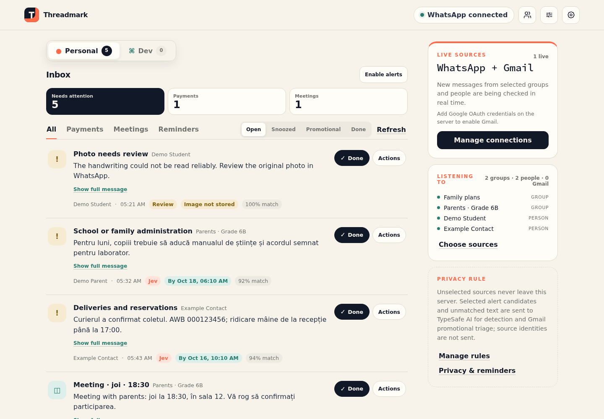
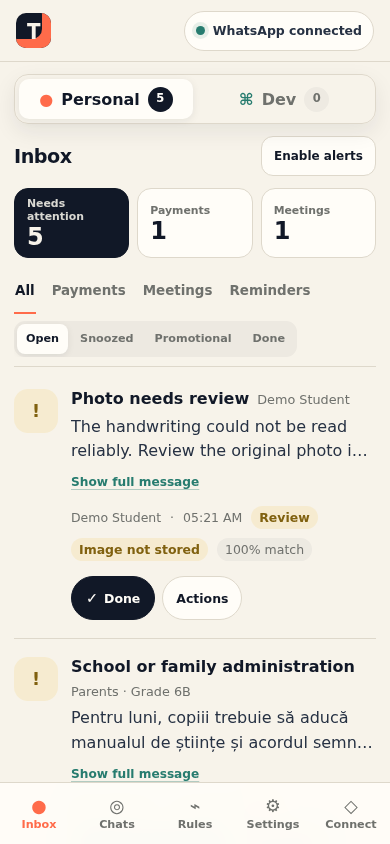
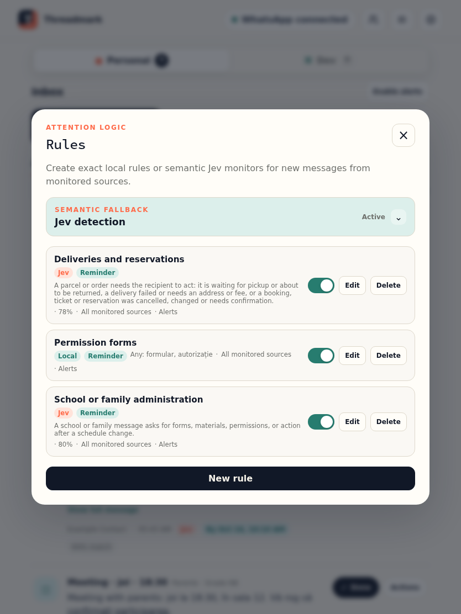
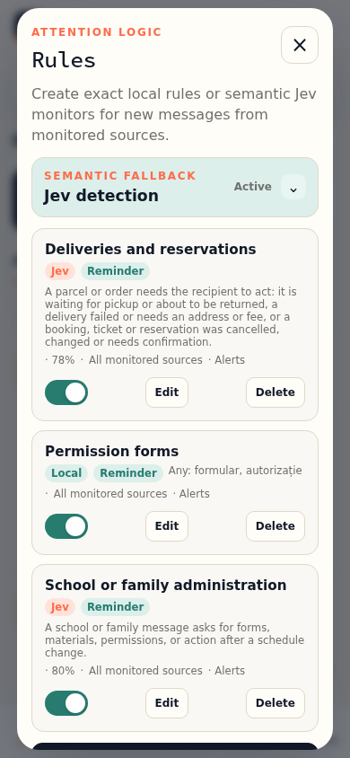

# Threadmark

Threadmark is a private, installable attention inbox for selected WhatsApp chats and Gmail sources. Read-only connectors receive new messages, deterministic detectors and your own phrase rules identify items that matter, and the PWA shows only the resulting attention items.

> **Important:** the linked-device connector is unofficial. WhatsApp can change its protocol or restrict an account using an unofficial client. Threadmark deliberately does not send messages, mark messages as read, change presence or scrape history. Groups and people are disabled until you explicitly select them.

## Portfolio preview

The images below are captured from the real PWA using a temporary database and entirely synthetic chats. No personal WhatsApp data is used.

| Desktop inbox | Mobile inbox |
| --- | --- |
| [](docs/images/portfolio/threadmark-desktop-1440x1000.png) | [](docs/images/portfolio/threadmark-mobile-390x844.png) |

| Tablet rules | Mobile rules |
| --- | --- |
| [](docs/images/portfolio/threadmark-tablet-rules-834x1112.png) | [](docs/images/portfolio/threadmark-mobile-rules-390x844.png) |

## Documentation

- [User guide](docs/USER_GUIDE.md) — setup in the PWA, chat selection, rules, inbox actions, alerts and media.
- [Architecture](docs/ARCHITECTURE.md) — components, data flow, storage, detection pipeline and extension points.
- [Deployment and operations](docs/DEPLOYMENT.md) — direct Node, Podman Compose, Quadlet, upgrades, backups and troubleshooting.
- [Privacy and security](docs/PRIVACY.md) — local/external data boundaries, credentials, retention and risks.
- [API reference](docs/API.md) — browser, administrator and bridge endpoints.
- [Development guide](docs/DEVELOPMENT.md) — repository map, tests, detector work and synthetic screenshot generation.

## Architecture

- `threadmark-bridge`: Baileys linked-device client, QR/pairing-code control endpoint and persistent delivery outbox.
- `threadmark-gmail` / `threadmark-gmail-dev`: isolated Gmail OAuth clients with separate credentials, checkpoints and durable outboxes.
- `threadmark-app`: static PWA, invitation/device authentication, detectors, SQLite storage, live SSE feed and Web Push.
- `pwa-invite-console`: the existing external private console; Threadmark implements its standard admin API contract.
- `pwa-kit`: vendored service-worker update mechanism in `app/web/`.

The two connectors and app run as separate rootless Podman containers on a private network. Connectors publish no host ports. Only the app binds to `127.0.0.1:4391`, for a local reverse proxy or Tailscale Serve.

## What works

- Single-use device invitations and revocable device sessions.
- Full `pwa-invite-console` device/invitation API contract.
- WhatsApp QR or phone-number pairing.
- Live receipt of new group and individual-chat messages.
- Separate group and contact allowlists; every source is off by default.
- Personal and Dev profiles with separate feeds, counters, sources, rules, Done/Snoozed/Promotional views and labeled notifications.
- Sticky Personal/Dev switch with live Needs attention badges for both profiles, visible while scrolling on desktop and mobile.
- Two isolated read-only Gmail OAuth connections with independent label and discovered-sender allowlists.
- Gmail incremental synchronization every 60 seconds, starting at connection time without importing old mail.
- Metadata-first routing: complete email bodies are fetched only for enabled labels or senders; attachments are not downloaded.
- Contact discovery from WhatsApp metadata and new incoming chats, without retaining unselected message content.
- Canonical phone-contact identity resolution for WhatsApp's private LID delivery addresses.
- Search for known groups and people, with phone-number lookup for contacts WhatsApp has not replayed to the linked device.
- Import selected contacts through the browser's privacy-preserving Contact Picker when the device supports it.
- Romanian and English invoice, payment and meeting detectors. Concrete invoice notices do not require an amount or IBAN; paid receipts, order confirmations and group members' reports of payments they made ("Am transferat pentru…") are ignored unless they contain a new action to take.
- Built-in subscription lifecycle monitoring for purchases, starts, renewals, re-subscriptions, price changes, expirations, cancellations and payment failures; clearly labeled test purchase receipts stay quiet.
- Local custom rules with any/all phrase matching, category, chat scope, enable/disable controls, optional notifications and a sample-text tester.
- Optional Jev semantic fallback for locally unmatched invoice, payment, meeting and reminder messages, plus generic payment verification, Gmail meeting verification and conservative promotional triage.
- User-defined semantic monitors with plain-language conditions, per-monitor thresholds, chat scope, notifications and a Jev sample tester.
- Jev urgency probability stored as a priority signal; high-urgency items rise in the feed and receive a visible badge and urgent notification title.
- Local absolute/relative deadline extraction, due/overdue badges and downloadable calendar events.
- Snooze, a reviewable Promotional view, daily digest, useful/not-relevant feedback and category correction controls.
- Grouped notifications: alerts still on screen fold into one summary per profile ("3 alerts · 2 payments, 1 action"); dismissing it or opening the app starts a fresh count.
- Privacy-safe export of rules and monitors for sharing or version control (`scripts/export-rules.mjs`).
- Optional context-aware correction/cancellation detection with a 48-hour local rolling buffer.
- Optional outgoing-message monitoring that closes reply reminders when you answer.
- Conservative payment warnings for changed details, changed amounts, possible duplicates and unusual credential/payment language.
- Optional local image/PDF OCR and multilingual voice-note transcription with Tesseract, Poppler and whisper.cpp inside the bridge container.
- Source excerpts, confidence, group or person, sender and detected details.
- Mark done/reopen data model, live updates through SSE, and automatic feed/counter reconciliation whenever the PWA returns to the foreground.
- Optional Web Push notifications with supported-platform Done and Actions buttons.
- Network-first PWA shell with automatic safe updates and `/bust` recovery.
- Rootless Podman Quadlet deployment and `podman compose` support.

## Local development

Node 24 or later is required.

```bash
npm --prefix app ci
npm --prefix bridge ci
npm --prefix gmail ci
npm test
```

Regenerate the synthetic portfolio screenshots without touching the production database:

```bash
npm run screenshots
```

The command starts a temporary local server, uses an in-process fake Jev adapter, writes the images and manifest under `docs/images/portfolio/`, then deletes the temporary database.

Create temporary per-container environment files outside Git (`deploy/*.env` is ignored):

```bash
THREADMARK_CONFIG_DIR="$PWD/deploy" \
  node scripts/create-env.mjs https://threadmark.example
```

For a non-HTTPS localhost trial only, change `COOKIE_SECURE=0` in `deploy/app.env`. Then either run both processes directly or use Podman:

```bash
set -a
. deploy/app.env
set +a
DATA_DIR="$PWD/data/app" HOST=127.0.0.1 node app/server/index.mjs
```

In another terminal:

```bash
set -a
. deploy/bridge.env
set +a
DATA_DIR="$PWD/data/bridge" HOST=127.0.0.1 node bridge/index.mjs
```

Start the optional Personal Gmail connector in a third terminal after configuring Google OAuth:

```bash
set -a
. deploy/gmail.env
set +a
DATA_DIR="$PWD/data/gmail" HOST=127.0.0.1 node gmail/index.mjs
```

For Dev Gmail, start another process with its own data directory and profile identity:

```bash
GMAIL_PROFILE_ID=dev DATA_DIR="$PWD/data/gmail-dev" HOST=127.0.0.1 PORT=4394 node gmail/index.mjs
```

Create the first device invitation through the private admin endpoint or after registering the app in `pwa-invite-console`:

```bash
curl -sS http://127.0.0.1:4391/api/admin/invites \
  -H "X-Admin-Token: $ADMIN_TOKEN" \
  -H 'Content-Type: application/json' \
  --data '{"label":"My phone"}'
```

Open the returned URL, activate the device, connect the desired services and select the sources to monitor.

## Connect Gmail profiles

1. In [Google Cloud Console](https://console.cloud.google.com/), create or select a project and enable **Gmail API**.
2. Configure the OAuth consent screen as **External**. While it is in Testing, add your Gmail address as a test user.
3. Set the application home page to `https://your-threadmark-origin/about`, the privacy policy to `https://your-threadmark-origin/privacy`, and upload `app/web/icons/oauth-logo-120.png` as the app logo.
4. Create an OAuth client of type **Web application**. Add exactly `https://your-threadmark-origin/api/gmail/oauth/callback` as an authorized redirect URI.
5. Store the client ID and secret without printing them:

   ```bash
   node scripts/configure-gmail.mjs
   ./deploy.sh
   ```

6. Select **Personal** or **Dev**, open **Connect**, authorize the matching Gmail account, then enable labels or senders under **Monitored sources**.

Both connections use the same OAuth client and callback URI but store separate encrypted refresh tokens and Gmail history checkpoints. Connection does not enable a source: Gmail labels and senders, including **INBOX**, remain off until selected independently in each profile. Reconnection establishes a current checkpoint and does not backfill earlier mail. The Dev profile begins with five editable Jev monitors for security/access changes, build or deployment failures, store/policy actions, direct review requests and actionable user issues; these rules do not apply to Personal unless an equivalent Personal rule is created.

Google OAuth apps left in External **Testing** mode issue refresh tokens that normally expire after seven days for Gmail scopes. For unattended personal monitoring, move the consent screen to **In production**. Google may show an unverified-app warning or require verification if the app is distributed to other users; Threadmark requests only `gmail.readonly` and does not publish your credentials.

## Podman Compose

After creating `deploy/app.env`, `deploy/bridge.env` and `deploy/gmail.env`:

```bash
podman compose up --build -d
curl -fsS http://127.0.0.1:4391/api/health
```

Data lives under `./data` by default. Override `THREADMARK_DATA_DIR` and `THREADMARK_CONFIG_DIR` when needed.

## Production with Quadlet

Create the environment files in their production location (`~/.config/threadmark/app.env`, `bridge.env` and `gmail.env`):

```bash
node scripts/create-env.mjs https://your-threadmark-origin
```

Then run:

```bash
./deploy.sh
```

The deployment script:

1. installs pinned dependencies;
2. runs the tests;
3. builds both rootless Podman images;
4. installs the network and four container Quadlets under `~/.config/containers/systemd/`;
5. starts the app, verifies health, then starts WhatsApp plus the isolated Personal and Dev Gmail connectors.

Expose the app over a private HTTPS origin. A dedicated Tailscale Serve port avoids service-worker scope conflicts with other PWAs:

```bash
tailscale serve --bg --https=8444 http://127.0.0.1:4391
```

Use that exact HTTPS origin as `PUBLIC_BASE_URL` when creating the environment file.

## Add to `pwa-invite-console`

The supplied installer reads the per-app `ADMIN_TOKEN`, inserts a tailnet-only Caddy route, adds the app definition and icon, validates Caddy, then reloads it:

```bash
sudo python3 scripts/install-console-route.py
```

Defaults:

- Caddyfile: `/etc/caddy/Caddyfile`
- console configuration: `/var/www/pwa-invite-console/apps.json`
- route prefix: `/threadmark/api/*`
- backend: `127.0.0.1:4391`

Override the paths and insertion anchor with `THREADMARK_CADDYFILE`, `THREADMARK_CONSOLE_APPS`, `THREADMARK_CONSOLE_ANCHOR` and `THREADMARK_CONFIG_DIR`.

The public/tailnet PWA route must never inject the admin token. Only the private invitation-console route should supply `X-Admin-Token`.

## Privacy and retention

- WhatsApp session credentials stay only in the bridge data volume.
- Each Gmail refresh token is encrypted with AES-256-GCM in its profile-specific Gmail data volume. The encryption key and Google OAuth client secret stay in the mode-`0600` environment file.
- Gmail access is read-only. Threadmark first retrieves headers and labels, then fetches the full body only when a source is enabled. Attachments are not fetched.
- The app never receives raw encryption keys.
- New group and individual-chat events are routed only between the local bridge and app containers.
- Unselected message content is rejected before detection and long-term storage.
- Selected messages with no detection are not retained.
- Matched excerpts stay in the local SQLite database.
- Custom rule and semantic-monitor definitions stay in that same local database. Phrase test samples are evaluated locally and are not saved.
- When Jev is enabled, the text of an otherwise-unmatched message, a locally matched Gmail meeting candidate, or any local alert candidate from a selected source is sent to TypeSafe AI. Gmail candidates can be routed quietly to the local Promotional view by the narrow policy described below. Threadmark does not send the source name, sender name, email address, phone number, WhatsApp ID or message ID.
- Jev receives only coarse channel context: Gmail or WhatsApp, group/individual/mailbox, and boolean Gmail bulk-mail hints such as Promotions category or the presence of `List-Unsubscribe`. Header values are not sent, and no single hint determines the result.
- Context-aware changes/cancellations and reply monitoring are off by default. If enabled, selected-chat text and direction labels are held locally for at most 48 hours and recent text may be sent to Jev; identities and IDs are still removed.
- Outgoing messages are ignored unless reply monitoring is explicitly enabled.
- Attachment reading is off by default. If enabled, selected-chat media is downloaded and decrypted by the local bridge, processed inside the container, and deleted immediately. Only extracted text follows the same local/Jev routing rules as typed text.
- Jev test samples are sent to TypeSafe AI but are not saved by Threadmark. TypeSafe's own retention terms apply to all Jev requests.
- API and internal responses are never cached by the service worker.
- Message content is never intentionally written to logs.
- The default retention setting is 30 days; open attention items are preserved.

Back up the app, bridge and both Gmail data directories together with the environment file, using encryption. Treat every connector directory, the environment file and `BRIDGE_TOKEN` as account credentials.

## Jev semantic detection

Threadmark always runs its deterministic detectors and local phrase rules first. Concrete Romanian or English invoice notices are stored locally as Payment items even when the message contains no amount or IBAN. When Jev is enabled, the app batches independent invoice, payment, meeting, reminder, urgency, promotional, personal-obligation, transactional and recipient-specific Noul questions with any applicable semantic-monitor questions. If the local layer found nothing, a matching custom monitor takes precedence; otherwise a positive invoice judgment becomes a Payment item at `JEV_INVOICE_THRESHOLD` (default `0.68`) and the strongest generic built-in result uses `JEV_THRESHOLD` (default `0.78`). The lower invoice threshold reflects the higher cost of missing a bill, while the narrow question explicitly excludes marketing and hypothetical invoicing content.

Marketing email often combines words such as “call” with dates or times, so a local Gmail meeting match is sent through the same Jev questions. The local meeting is kept only when Jev's meeting probability reaches `JEV_THRESHOLD`; confirmed cards show **Rule + Jev**. An alternate Jev category may still be emitted when it reaches the threshold. If Jev is unavailable or omits the meeting score, Threadmark fails open and keeps the local meeting.

WhatsApp uses the stricter `whatsapp-promo-v1` policy (at least `0.95` promotional and at most `0.15` personal-obligation probability), which can also move a generic payment found only by Jev; locally detected payments stay protected. Gmail mass promotions — at least `0.9` promotional and at most `0.15` transactional and recipient-specific — are routed even when they look like subscription notices or reply requests; invoices, bank details, explicit payment requests and your own rules and monitors are never routed this way. Gmail newsletters that merely quote prices are also routed when Jev judges the price-only payment match unlikely to be real (`<= 0.35`) and neither an obligation nor aimed at you (`<= 0.15` each). For Gmail, policy `gmail-promo-v2` routes an unprotected candidate to **Promotional** when Jev assigns either at least `0.95` promotional probability and at most `0.30` personal-obligation probability, or at least `0.85` promotional probability with obligation, transactional and recipient-specific probabilities all at most `0.15`. No newsletter header or sender alone determines this decision. The item remains in the local database and reviewable Promotional view, but is excluded from Inbox counters, push notifications and due reminders. **Move to inbox** restores it and records useful feedback; **Not relevant** resolves it.

Generic local payment matches receive a focused payment judgment in the same Jev request. A match can be routed quietly when payment probability is at most `0.20` and promotional probability is at least `0.85`, even if marketing personalization inflates its recipient-specific scores. Invoices, subscription events, explicit payment requests, bank instructions, user-created phrase rules, semantic monitors and photo-review alerts remain protected. Missing judgments and Jev failures retain local alerts. WhatsApp keeps shadow scoring and is never automatically routed to Promotional.

Payment-history warnings compare Gmail payments from the same sender within the same profile, across selected labels. WhatsApp comparisons use the same sender within the same chat. Rejected and Promotional items are excluded from payment-history comparisons, and promotional payment candidates do not acquire safety warnings.

Numeric extraction excludes decimal percentages and performance multipliers from calendar dates, respects AM/PM, and does not read a day beside a currency-prefixed price as the amount. Meeting evidence stays within one paragraph. Local deadline fallback requires task or scheduling context; when Jev judges that no actionable date exists, fallback does not invent one. A separate actionable-date Noul must reach `0.80` before Jev's date choices are accepted. Promotional items do not carry actionable due dates.

The policy applies only while new messages are ingested; it does not reclassify the existing Inbox or historical feedback. Jev/API failure is fail-open, so a local match remains visible rather than being silently discarded.

The urgency probability is stored separately as the item's priority; values at or above `0.78` are surfaced as urgent.

Promotional triage expands the Jev privacy boundary to local alert candidates from selected sources. Enabling context-aware or reply monitoring additionally expands the input to recent selected-source text as described in the PWA. Disable Jev to keep local detections and phrase-rule matches entirely on the server.

Configure the API key without placing it in shell history or the browser:

```bash
node scripts/configure-jev.mjs
systemctl --user restart threadmark-app.service
```

The script uses `systemd-ask-password`, stores the key only in the mode-`0600` Threadmark environment file and never prints it. To stop sending selected message text to TypeSafe while retaining the key:

```bash
node scripts/configure-jev.mjs --disable
systemctl --user restart threadmark-app.service
```

## Exporting rules

Phrase rules and semantic monitors can be shared or kept in Git without the data stored around them:

```bash
node scripts/export-rules.mjs --out threadmark-rules.json
```

The export contains only each rule's name, profile, kind, category, phrases or condition, threshold and notification/enabled flags. It refuses rules limited to specific chats or senders, because their scope consists of phone numbers, group IDs and email addresses; add `--skip-scoped` to leave those out. It also refuses any rule whose text looks like a phone number, email address or WhatsApp/Gmail ID. The script reads `~/.local/share/threadmark/app/threadmark.sqlite` read-only; pass another database path as an argument. Never commit the database itself. [`examples/threadmark-rules.json`](examples/threadmark-rules.json) is a real export of the author's monitors.

## Extending detectors

Detectors live in `app/server/detectors.mjs` and return a stable attention-item shape. Add new detector modules behind the same contract rather than changing the bridge. Connector events remain normalized to:

```js
{
  id, sourceId, sourceName, sourceKind, senderId, senderName, sentAt, text, direction, media
}
```

This keeps later Telegram or official WhatsApp Business connectors independent from the PWA and storage layer. Gmail already implements this boundary.

For personal matching needs, no code change is required: open **Rules** in the PWA and choose either **Phrase rule · local** or **Semantic monitor · Jev**. Phrase rules match any/all terms case- and accent-insensitively inside the local app container. Semantic monitors express a narrow condition in ordinary language and have an adjustable probability threshold. Both can be restricted to selected chats and apply only to new messages.

## License

Threadmark is free software licensed under the [GNU General Public License v3.0 only](LICENSE), SPDX identifier `GPL-3.0-only`. This matches the license of the vendored `pwa-kit` update mechanism.
